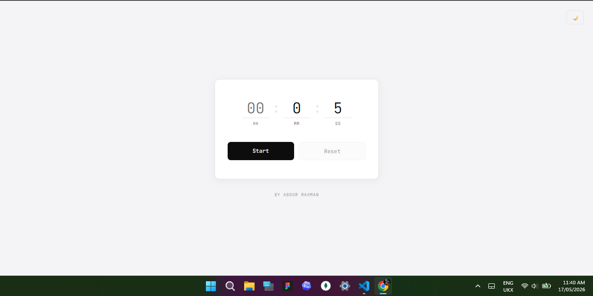
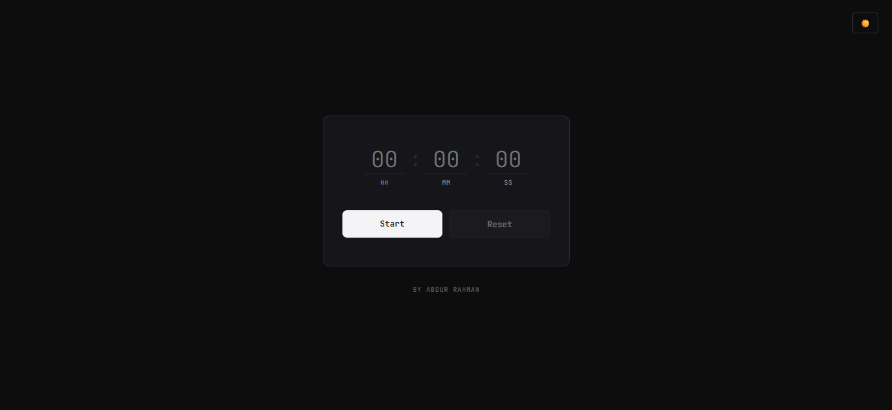
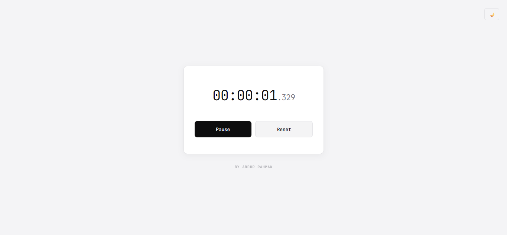

# Minimalist Countdown Timer

A browser-based countdown timer built with **HTML, CSS, and vanilla JavaScript**. Set a duration in hours, minutes, and seconds, then start, pause, or reset the countdown.

## Features

- Hours, minutes, and seconds inputs
- Start and pause controls
- Reset control
- Countdown display with formatted time
- Light and dark theme support

## Run locally

Open `Timer/index.html` in a browser. Keep the `Timer/assets/` folder beside the page so the styles and script load.

## Built with

- HTML5
- CSS3
- Vanilla JavaScript

## Screenshots

| Ready | Running |
| --- | --- |
|  |  |
